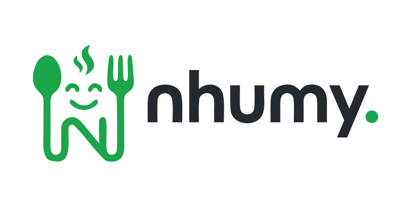

## 🚀 My Products

<table width="100%">
  <tr>
    <td valign="top" width="50%" align="center">
      
      <h3>PawseKeys</h3>
      <p><em>Lock the keyboard. Clean, protect, focus.</em></p>
      <p>A native macOS keyboard-locking utility — one-click lock, menu bar controls, countdown timers, and an Apple Watch companion. Built in Swift, offline-first, zero data collection.</p>
      <p>
        <a href="https://pawsekeys.app">
          
        </a>
        <br /><br />
        <a href="https://apps.apple.com/pt/app/pawsekeys-lite/id6761140255?l=en-GB&mt=12">
          
        </a>
      </p>
    </td>
    <td valign="top" width="50%" align="center">
      
      <p><em>Ementa digital para restaurantes.</em></p>
      <p>Digital menus for restaurants in Portugal — create your menu in minutes, generate QR codes, and receive orders via WhatsApp. Free to start. Built with React, Vite & Supabase.</p>
      <p>
        <a href="https://nhumy.app">
          
        </a>
      </p>
    </td>
  </tr>
</table>

---

<table width="100%">
  <tr>
    <td valign="top" width="60%">

<h1>Hey, I'm Pablo Campina 👋</h1>

<p><strong>Full Stack Developer & Indie Maker · 14+ years of experience · 🇧🇷 → 🇵🇹</strong></p>

<p>
  I build scalable, high-quality web applications — from pixel-perfect UIs to robust backend systems — 
  and ship my own products, from native macOS apps to SaaS for restaurants. 
  Over the past 14+ years, I've delivered impactful software for industry leaders across automotive, 
  engineering, and telecommunications sectors.
</p>

<p>
  💼 &nbsp;Previously collaborated with &nbsp;
  <strong>BMW Group</strong> &nbsp;·&nbsp;
  <strong>Capgemini Engineering</strong> &nbsp;·&nbsp;
  <strong>Ericsson</strong>
</p>

<p>
  📍 Lisbon, Portugal &nbsp;&nbsp;
  📬 <a href="mailto:pablo@campina.dev">pablo@campina.dev</a>
</p>

<p>
  🌱 Currently focused on <strong>Swift & native macOS apps</strong>, <strong>Supabase</strong> & <strong>AI-assisted development</strong>
</p>

<p>
  <a href="https://linkedin.com/in/pablocampina">
    
  </a>
  &nbsp;
  <a href="mailto:pablo@campina.dev">
    
  </a>
</p>

  </td>
  <td valign="center" width="40%" align="center">
    
    <br /><br />
    
  </td>
  </tr>
</table>

---

## 🧠 About Me

```typescript
const pabloCampina = {
  role:        "Full Stack Developer & Indie Maker",
  experience:  "14+ years",
  location:    "Lisbon, Portugal 🇵🇹",
  origin:      "Brazil 🇧🇷",
  focus:       ["Scalable Web Apps", "Clean Architecture", "Developer Experience"],
  products:    ["PawseKeys 🐾", "Nhumy 🍔"],
  learning:    ["Swift & macOS", "Supabase", "AI-assisted development"],
  contact:     "pablo@campina.dev",
};
```

---

## 🛠️ Tech Stack

**Frontend**


**Native & Mobile**


**Backend**


**Databases**


**DevOps & Cloud**


**AI & Tooling**


